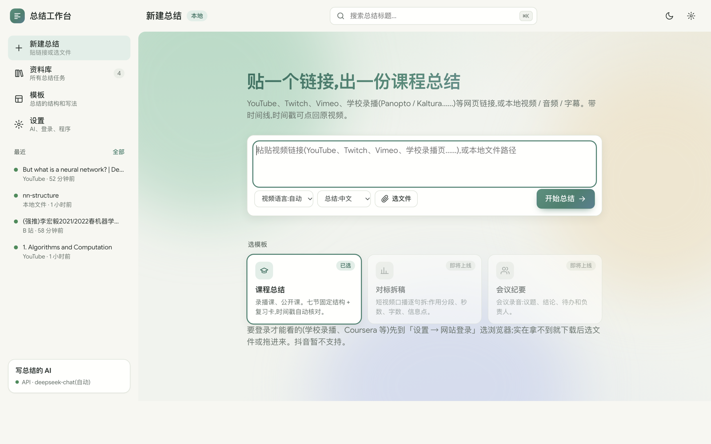

# Lecture Summary Toolkit

**English** | [中文](README.zh.md)

Turn a lecture video into a study summary you can actually revise from: a timeline you can click back into the video, key points with timestamps, exam signals, and review cards. Transcription runs on your own computer.

It comes in two parts:

| | What it is | For |
|---|---|---|
| **Workbench** (`workbench/`) | A local web app. Paste a link or drop a file, get a summary. | Most people |
| **Skill** (`skills/video-summary/`) | Instructions plus scripts for Claude Code / Codex. Summarise lecture recordings from a chat, with slide OCR, frame capture and an exam-signal bank. | People who already work in Claude Code or Codex |

## Workbench


<details><summary>New-summary page</summary>



</details>

- **Paste almost any lecture link.** YouTube, Twitch, Vimeo, TED, SoundCloud, Bilibili, and university lecture-capture pages such as Panopto and Kaltura. Under the hood this is [yt-dlp](https://github.com/yt-dlp/yt-dlp), which supports more than a thousand sites. Local video, audio, `.srt` and `.vtt` files work too.
- **Subtitles first, transcription second.** If the site has subtitles, they are used as-is. Otherwise the audio is downloaded and transcribed locally with [whisper.cpp](https://github.com/ggml-org/whisper.cpp) (large-v3-turbo, with voice-activity detection).
- **No API key needed if you already pay for ChatGPT or Claude.** The summary is written by an AI you already have:
  - **Claude Code**, signed in with your Claude Pro / Max plan
  - **Codex CLI**, signed in with your ChatGPT Plus / Pro plan
  - or **any OpenAI-compatible API** (DeepSeek by default) if you prefer pay-as-you-go
- **Three templates.** *Lecture summary* (fixed seven-part notes with review cards); *Script breakdown* for short videos (sentence-by-sentence segments by role, with seconds, word counts and pace computed by code, not the AI); *Meeting notes* in five types (standard, daily standup, project sync, retrospective, client call), adapted from [Meetily](https://github.com/Zackriya-Solutions/meetily).
- **Checked, not just generated.** Every timestamp is checked against the transcript. If something is out of range or lands in silence, the AI is asked to fix it once.
- **Click a timestamp, jump to that second.** YouTube and Bilibili play inside the page. Twitch and Vimeo open at the right time. Local files play in the built-in player.
- **English and Chinese.** Switch the interface with the button in the top bar (it follows your browser language the first time, or open `?lang=en`). Each summary can be written in English or Chinese.
- **Calm by design.** Low-saturation colour themes (sage, lavender dusk, morning mist), light and dark, because revision is stressful enough.

### First time? Five steps (macOS)

1. **Open Terminal.** Press ⌘ Space, type `Terminal`, press Return.
2. **Get the code.** Paste this and press Return (if your Mac asks to install developer tools, click Install and run it again):

   ```bash
   git clone https://github.com/camzhou831-star/lecture-summary-toolkit.git
   ```

   No git? Click **Code → Download ZIP** on GitHub and unzip it instead.
3. **Run the setup script.** It installs whatever is missing (skipping what you already have), then starts the workbench and opens it in your browser:

   ```bash
   bash lecture-summary-toolkit/workbench/setup.sh
   ```

   If it says Homebrew is missing, it prints the one line to install it. Run that, then run the script again.
4. **Follow the "Before you start" card** at the top of the page. It checks what's installed and gives you a command to copy for anything that's missing. The main thing is the AI that writes summaries: if you pay for Claude or ChatGPT, install Claude Code or Codex and sign in once. No API key needed.
5. **Paste a lecture link and click Summarize.** The first transcription also downloads a speech model (about 1.6 GB, once only). Long videos take a few minutes; the browser tab shows ✓ when it's done.

**Next time:** run `bash lecture-summary-toolkit/workbench/setup.sh` again. It skips the installs and just starts the workbench.

<details><summary>Manual setup (if you'd rather do it yourself)</summary>

**1. Install the tools**

```bash
brew install uv yt-dlp ffmpeg whisper-cpp
```

The whisper model (about 1.6 GB) downloads automatically the first time something is transcribed.

**2. Pick the AI that writes the summary.** You only need one of these:

| You have | Do this once |
|---|---|
| Claude Pro / Max | `npm i -g @anthropic-ai/claude-code`, then run `claude` and sign in |
| ChatGPT Plus / Pro | `npm i -g @openai/codex` (or `brew install codex`), then run `codex` and sign in |
| An API key | Put it in `~/.config/lecture-workbench/config.json` as `{"api_key": "sk-..."}`. The default endpoint is DeepSeek; set `base_url` and `model` for any OpenAI-compatible API. |

On **Auto** (the default), the workbench uses an API key if there is one, otherwise Claude Code, otherwise Codex. You can change this under **Settings**.

**3. Start it**

```bash
git clone https://github.com/camzhou831-star/lecture-summary-toolkit.git
cd lecture-summary-toolkit/workbench
uv run python -m wb
```

Open <http://127.0.0.1:8770>. If the port is taken, run `PORT=8771 uv run python -m wb`.

</details>

### Lectures behind a login

University recordings (Panopto, Echo360, Kaltura, YuJa) and course sites (Coursera, Udemy) usually need you to be signed in. In **Settings → Site login**, choose a browser you are already signed in with. yt-dlp then borrows that browser's cookies when downloading, on your machine only. This is off by default. If a site still refuses, download the video yourself and drop the file in.

### What gets sent where

- Downloading and transcription happen on your computer.
- The transcript, and only the transcript, is sent to the AI you chose (Claude, ChatGPT or your API provider) to write the summary.
- Each task's files (transcript, summary `.md`) are saved in `workbench/data/`, which git ignores.
- Only download videos you are allowed to use for your own study. Do not redistribute them.

More detail (architecture, test results, limits): [`workbench/README.md`](workbench/README.md).

## Skill for Claude Code / Codex

For full lecture recordings with slides. It captures frames, runs OCR and matches slides, writes a timestamped summary with a fixed seven-section structure, then checks it.

```bash
bash install.sh          # macOS / Linux: dependencies + links the skill into Claude Code and Codex
bash lsk doctor --video  # check what is installed
```

On Windows, double-click `install.cmd`. After installing, say *"summarize &lt;video or subtitle file&gt;"* in Claude Code or Codex. The workflow is in [`skills/video-summary/SKILL.md`](skills/video-summary/SKILL.md), and the writing rules, which the workbench also uses, are in [`policy.md`](skills/video-summary/policy.md).

## Credits

- UI design tokens and layout adapted from [TreeUI](https://github.com/Viserion77/treeui) (MIT)
- Meeting-notes templates and prompt rules adapted from [Meetily](https://github.com/Zackriya-Solutions/meetily) (MIT); see `workbench/templates/meeting/`
- [yt-dlp](https://github.com/yt-dlp/yt-dlp), [whisper.cpp](https://github.com/ggml-org/whisper.cpp), [FFmpeg](https://ffmpeg.org/)

## License

MIT
