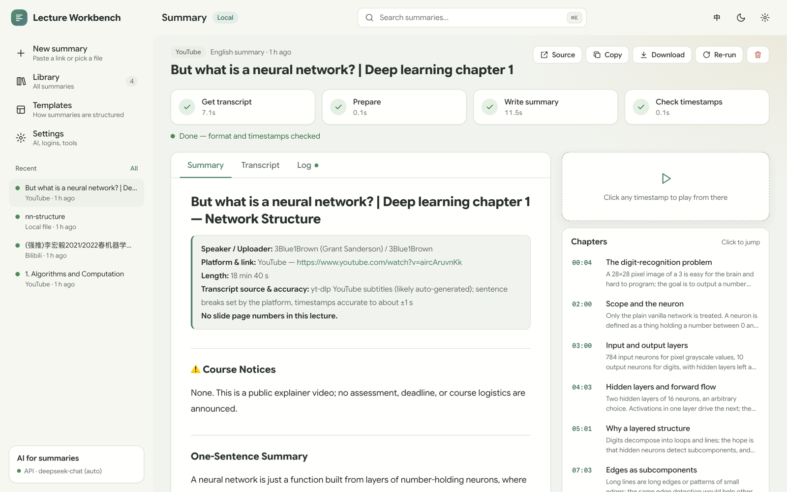

# Lecture Summary Workbench

**English** | [中文](README.zh.md)

**Paste a link to an online lecture or class recording, and a few minutes later you get a summary you can revise from.** Every section has a timestamp; click it and the video jumps to that second.

It runs on your own computer. On Mac and Windows you download it and double-click to start.



## What it's for

- **You missed a 90-minute lecture and don't want to watch all of it.** Read the summary first, and click the timestamp for the part you didn't get.
- **When you revise.** Anything the lecturer flagged ("this will be on the exam", "pay attention here") is pulled out, course notices (assignments, deadlines, how marks are split) are collected, and there's a set of review cards you can drop straight into Obsidian.
- **Learning how good short videos are written.** Paste a short video and it breaks the script down sentence by sentence: how it hooks you, what each part does, how fast it talks.
- **Writing up a meeting.** Drop in the recording and get the decisions, who owns what, and a timestamp for each.

## How is this different from pasting into ChatGPT?

- **No hunting for subtitles or transcripts.** Paste the link. If the site has subtitles it uses them; if not, it transcribes the audio on your computer.
- **The timestamps are checked.** Each one is checked against the transcript, so clicking it really lands on that second. The AI didn't just make it up.
- **It doesn't copy the lecturer's mistakes.** After the summary is written, a second AI checks it against the transcript and slides. Each problem it finds is checked twice more, independently, and only fixed if both agree. Anything still uncertain is marked "to check" in place, with both readings, rather than written as fact.
- **It can read the slides and the screen.** Attach the lecture's slides as a PDF and the summary cites page numbers. For local videos it also reads the text on screen, such as a marking rubric the lecturer put up.

## Get started in three steps

1. **Download.** From the [latest release](https://github.com/camzhou831-star/lecture-summary-toolkit/releases/latest): `lecture-workbench-mac.zip` for Mac, `lecture-workbench-windows.zip` for Windows. Unzip it.
2. **Double-click to start.** On Mac, double-click `启动工作台.command` ("Start Workbench"); on Windows, `启动工作台.bat`. The first run installs what it needs, then opens the workbench in your browser.
   - Mac says it "cannot be verified" the first time: Control-click the file and choose Open. On newer macOS without that button, go to System Settings → Privacy & Security and click Open Anyway.
   - Windows shows "Windows protected your PC": click More info → Run anyway.
   - Keep the window that pops up open while you use it; closing it stops the workbench.
3. **Pick an AI to write the summaries.** The "Before you start" checklist on the home page tells you what's missing. Use whichever you already have:

| You have | What to do | Extra cost |
|---|---|---|
| Claude Pro / Max | Install Claude Code and sign in once | None, it's part of your plan |
| ChatGPT Plus / Pro | Install Codex and sign in once | None, it's part of your plan |
| A DeepSeek account | Install the [DeepSeek Harness](https://www.deepseek.com/en/harness/) desktop app and sign in once | Billed to your DeepSeek account |
| None of these | Paste an API key (DeepSeek by default, or any OpenAI-compatible service). `如何接入DeepSeek.html` in the download is a step-by-step guide (in Chinese) | Pay as you go; with DeepSeek, a 1.5-hour lecture costs a few cents including review |

Then paste a lecture link and click Summarize. The first transcription downloads a speech model of about 1.6 GB, once.

## FAQ

**Which sites work?** YouTube, Twitch, Vimeo, TED, Bilibili, and university lecture capture such as Panopto and Kaltura. Under the hood it's [yt-dlp](https://github.com/yt-dlp/yt-dlp), which supports over a thousand sites. You can also drag in local video, audio or subtitle files (`.srt` / `.vtt`).

**My university recordings need a login.** In Settings → Site login, pick a browser you're already signed in with, and the workbench borrows its login to download (only on your computer). If that still fails, download the video yourself and drag it in.

**Does my video get uploaded anywhere?** No. Downloading and transcription happen on your computer. Only the transcribed text goes to the AI you picked, to write the summary. Everything is saved in the workbench's own `workbench/data/` folder.

**Can summaries be in Chinese?** Yes. Each summary can be English or Chinese, and the interface comes in both.

**How long does it take?** For a one-hour lecture that already has subtitles, the first draft takes a minute or two; transcribing on your computer adds a few minutes. Lecture summaries are then reviewed for a few rounds, which takes around 10 minutes with DeepSeek for a 1.5-hour lecture. Slower, but nothing wrong goes in.

**Does Windows work?** It installs, but the full flow has only been tested on a Mac so far. Please open an issue if something breaks.

Only download videos you're allowed to use for your own study, and don't redistribute them.

<details><summary>Comfortable with a terminal? Install from source / by hand</summary>

**One command to install and start (macOS):**

```bash
git clone https://github.com/camzhou831-star/lecture-summary-toolkit.git
bash lecture-summary-toolkit/workbench/setup.sh
```

It installs whatever is missing and skips what you have; if Homebrew is missing it prints the install command. Run the same script again next time.

**Fully by hand:**

```bash
brew install uv yt-dlp ffmpeg whisper-cpp tesseract poppler
cd lecture-summary-toolkit/workbench
uv run python -m wb
```

Open <http://127.0.0.1:8770>. If the port is taken, use `PORT=8771 uv run python -m wb`.

You can also set the API key without the interface: put `{"api_key": "sk-..."}` in `~/.config/lecture-workbench/config.json`. The default endpoint is DeepSeek; for another OpenAI-compatible API, change `base_url` and `model`.

</details>

<details><summary>How it works (technical details)</summary>

- Getting the text: site subtitles first; otherwise the audio is downloaded and transcribed locally with [whisper.cpp](https://github.com/ggml-org/whisper.cpp) (large-v3-turbo, with voice activity detection).
- Reading the screen: for local videos, one frame every 12 seconds, de-duplicated, read with tesseract and matched to the slide PDF's pages.
- Writing: three templates. Lecture summary (a fixed seven-part structure plus review cards), script breakdown (seconds, word counts and pace computed by code), and meeting notes (five meeting types, templates from [Meetily](https://github.com/Zackriya-Solutions/meetily)).
- Checking: code checks every timestamp; a pass fixes misheard names of people and companies; lecture summaries then get several rounds of independent review.
- Backend FastAPI + SQLite; the frontend is plain HTML with no build step.

More detail, measured timings and known limits: [`workbench/README.md`](workbench/README.md) (in Chinese).

</details>

<details><summary>Already use Claude Code or Codex? There's also a Skill version</summary>

No web page: just say "summarise <video or subtitle file>" in Claude Code or Codex. It suits full lecture recordings with slides: frame capture, OCR, slide page matching, automatic checks, and a weekly exam-signal bank.

```bash
bash install.sh          # macOS / Linux: install dependencies and link the skill into Claude Code and Codex
bash lsk doctor --video  # check the setup
```

On Windows, double-click `install.cmd`. The flow is in [`skills/video-summary/SKILL.md`](skills/video-summary/SKILL.md) and the writing rules in [`policy.md`](skills/video-summary/policy.md), which the workbench uses too.

</details>

## Credits

- Interface colours and layout based on [TreeUI](https://github.com/Viserion77/treeui) (MIT)
- Meeting-note templates adapted from [Meetily](https://github.com/Zackriya-Solutions/meetily) (MIT)
- Downloading, transcription and media handling by [yt-dlp](https://github.com/yt-dlp/yt-dlp), [whisper.cpp](https://github.com/ggml-org/whisper.cpp) and [FFmpeg](https://ffmpeg.org/)

## License

MIT
