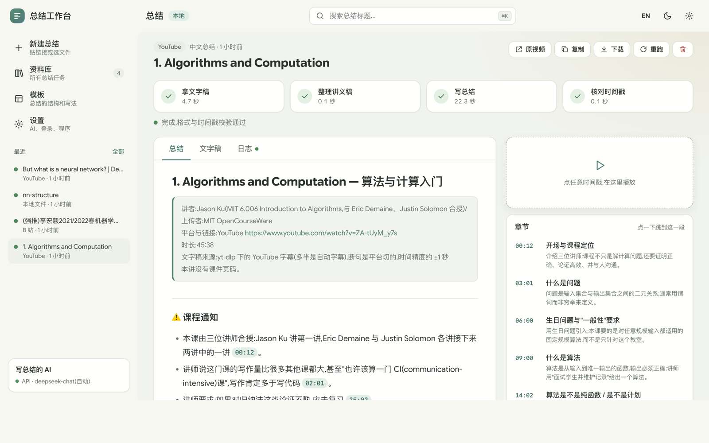

# 课程总结工作台

[English](README.md) | **中文**

**贴一个网课或录播链接，几分钟后拿到一份能直接拿来复习的总结。** 每一段都标了时间，点一下就跳回视频的那一秒。

装在你自己的电脑上，Mac 和 Windows 下载后双击就能用。



## 能帮你做什么

- **一节 90 分钟的录播课，不想从头再看一遍。** 先看总结，哪一段没懂，点时间跳过去只看那几分钟。
- **复习的时候。** 老师说过"这个会考""这里要注意"的地方会单独列出来，课程通知（作业、截止日期、分数构成）也会整理好，最后附一组复习卡，能直接放进 Obsidian 里刷。
- **学别人的短视频怎么写。** 贴一条爆款，它会逐句拆开：开头怎么抓人、每段起什么作用、语速多快。
- **开完会要写纪要。** 把录音或录像丢进去，整理出决定了什么、谁负责什么，每一条都带时间。

## 和直接丢给 ChatGPT 有什么不一样

- **不用自己找字幕、转文字。** 贴链接就行，网站有字幕就直接用；没有的话，它在你电脑上把声音转成文字。
- **时间点是核对过的。** 每个时间都对着原文字稿检查一遍，点了真能跳到那一秒，不是 AI 随口编的。
- **老师说错的地方不照抄。** 写完以后，会另外找一个 AI 对照原话和课件挑错，挑出来的问题再独立核对两次，都确认了才改。拿不准的地方，会在原处标「待核实」，把两种说法都写出来，不会当成事实写进去。
- **能看课件和屏幕。** 附上这节课的课件（PDF 或 PowerPoint 的 .pptx），总结会对上页码；只有课件、没有录播也行，会只根据课件整理一份复习笔记；如果是本地视频，它还会读屏幕上投的字，比如老师投屏的评分细则。

## 三步开始

1. **下载。** 到 [最新版本](https://github.com/camzhou831-star/lecture-summary-toolkit/releases/latest) 下载：Mac 下 `lecture-workbench-mac.zip`，Windows 下 `lecture-workbench-windows.zip`，然后解压。
2. **双击启动。** Mac 双击 `启动工作台.command`，Windows 双击 `启动工作台.bat`。第一次会自动装好需要的工具，然后在浏览器里打开工作台。
   - Mac 第一次会提示"无法验证"：按住 Control 点这个文件，选「打开」。新版 macOS 没有这个按钮的话，去「系统设置 → 隐私与安全性」点「仍要打开」。
   - Windows 如果弹出「Windows 已保护你的电脑」：点「更多信息」→「仍要运行」。
   - 用的时候，弹出来的那个黑色窗口别关，关了工作台就停了。
3. **选一个帮你写总结的 AI。** 工作台首页的「开始前检查」会告诉你还缺什么。按你手上有的选一个就行：

| 你有 | 怎么用 | 要不要另外花钱 |
|---|---|---|
| DeepSeek 账号 | 装 [DeepSeek Harness](https://www.deepseek.com/en/harness/) 桌面版，登录一次 | 按你 DeepSeek 账号的用量算 |
| Claude Pro / Max 会员 | 装 Claude Code，登录一次 | 不用，算在会员里 |
| ChatGPT Plus / Pro 会员 | 装 Codex，登录一次 | 不用，算在会员里 |
| 都没有 | 在 DeepSeek 开放平台充一点钱，拿一把 API Key 粘进工作台。安装包里的 **「如何接入DeepSeek.html」** 一步步教你 | 按量付费，一节 1.5 小时的课连写带审大约两三毛钱 |

然后贴一个课程链接，点「开始总结」。第一次转写要下载一个约 1.6 GB 的语音模型，只下一次。

## 常见问题

**支持哪些网站？** YouTube、B 站、Twitch、Vimeo、TED，还有 Panopto、Kaltura 这类学校录播系统，底层用的是 [yt-dlp](https://github.com/yt-dlp/yt-dlp)，一千多个网站都能用。本地的视频、音频、字幕文件（`.srt` / `.vtt`）也可以直接拖进来。抖音暂不支持。

**学校录播要登录才能看怎么办？** 在「设置 → 网站登录」里选一个你已经登录过的浏览器，工作台会借用它的登录状态下载（只在你电脑上用）。还是不行的话，自己下载视频再拖进来。

**我的视频会被传到网上吗？** 不会。下载和转写都在你电脑上完成，只有转出来的文字会发给你选的那个 AI 去写总结。所有文件都存在工作台自己的 `workbench/data/` 文件夹里。

**总结能写英文吗？** 可以。每份总结都能选中文或英文，界面也有中英两种。

**一份要等多久？** 有现成字幕的 1 小时课，一两分钟出初稿；要在本机转写的，转写要几分钟。课程总结写完还会审核几轮，用 DeepSeek 审核一节 1.5 小时的课大约 10 分钟。宁可慢一点，也不把错的写进去。

**Windows 能用吗？** 能装，但目前只在 Mac 上完整测过，Windows 还没在真机上跑过整个流程。遇到问题欢迎提 Issue。

只下载你有权用于个人学习的视频，不要再分发。

<details><summary>会用终端的话：从源码装 / 手动装</summary>

**一条命令装好并启动（macOS）：**

```bash
git clone https://github.com/camzhou831-star/lecture-summary-toolkit.git
bash lecture-summary-toolkit/workbench/setup.sh
```

缺什么装什么，已经有的会跳过；缺 Homebrew 的话会把安装命令打印出来。以后再用，再运行一次同一个脚本就行。

**完全手动：**

```bash
brew install uv yt-dlp ffmpeg whisper-cpp tesseract poppler
cd lecture-summary-toolkit/workbench
uv run python -m wb
```

打开 <http://127.0.0.1:8770>。端口被占的话用 `PORT=8771 uv run python -m wb`。

写总结的 AI 也可以不用界面配置：API Key 写进 `~/.config/lecture-workbench/config.json`，格式是 `{"api_key": "sk-..."}`；默认接口是 DeepSeek，换成别的 OpenAI 兼容接口就改 `base_url` 和 `model`。

</details>

<details><summary>它是怎么做的（技术细节）</summary>

- 拿文字：网站字幕优先，没有就下载音频，用 [whisper.cpp](https://github.com/ggml-org/whisper.cpp)（large-v3-turbo，带静音检测）在本机转写。
- 读画面：本地视频每 12 秒抽一帧，去重后用 tesseract 识别屏幕上的字，再和课件 PDF 对页码。
- 写总结：三种模板——课程总结（七节固定结构加复习卡）、对标拆稿（秒数、字数、语速由程序算）、会议纪要（5 种会议类型，模板取自 [Meetily](https://github.com/Zackriya-Solutions/meetily)）。
- 核对：程序检查每个时间戳；人名、公司名再过一遍（语音识别常把"黄仁勋"听成"黄云勋"）；课程总结再做多轮独立审核。
- 后端 FastAPI + SQLite，前端是纯 HTML，不用构建。

细节、实测耗时和已知限制见 [`workbench/README.md`](workbench/README.md)。

</details>

<details><summary>平时就用 Claude Code / Codex？还有一个 Skill 版</summary>

不开网页，直接在 Claude Code 或 Codex 的对话里说"总结 <视频或字幕文件>"。适合有课件的完整录播：抓帧、OCR、对课件页码，写完自动核对，还能把每周的考点汇总成考点库。

```bash
bash install.sh          # macOS / Linux：装依赖，并把技能链接到 Claude Code 和 Codex
bash lsk doctor --video  # 检查环境
```

Windows 双击 `install.cmd`。流程见 [`skills/video-summary/SKILL.md`](skills/video-summary/SKILL.md)，写作规则在 [`policy.md`](skills/video-summary/policy.md)（工作台用的也是这一份）。

</details>

## 致谢

- 界面的配色和布局参考了 [TreeUI](https://github.com/Viserion77/treeui)（MIT）
- 会议纪要模板改编自 [Meetily](https://github.com/Zackriya-Solutions/meetily)（MIT）
- 下载、转写和音视频处理靠 [yt-dlp](https://github.com/yt-dlp/yt-dlp)、[whisper.cpp](https://github.com/ggml-org/whisper.cpp)、[FFmpeg](https://ffmpeg.org/)

## 许可证

MIT
