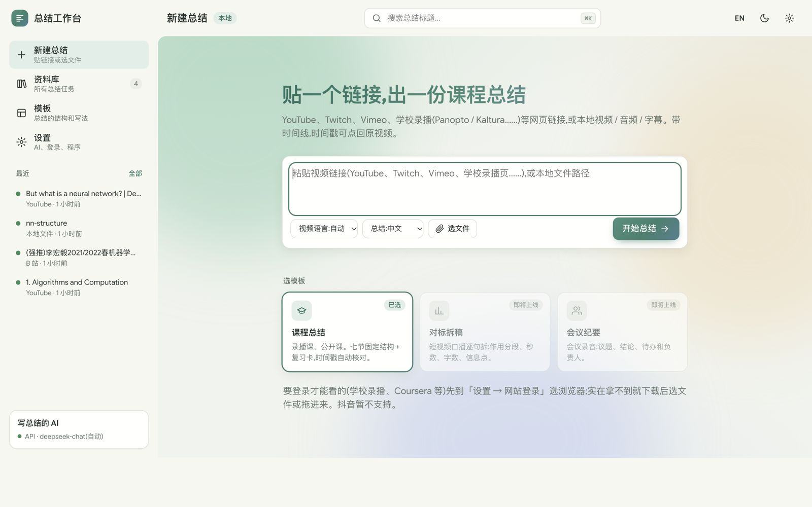

# 录播课总结工具

[English](README.md) | **中文**

把一节录播课变成能直接拿来复习的总结：章节时间线（点一下跳回视频那一秒）、带时间戳的核心要点、考点信号、复习卡。转写在你自己的电脑上跑。

分两部分：

| | 是什么 | 适合谁 |
|---|---|---|
| **工作台**（`workbench/`） | 本地网页。贴链接或拖文件进来，出总结 | 大多数人 |
| **Skill**（`skills/video-summary/`） | 给 Claude Code / Codex 用的说明和脚本，在对话里总结录播课，带课件 OCR、抓帧和考点库 | 平时就在用 Claude Code / Codex 的人 |

## 工作台


<details><summary>新建页</summary>



</details>

- **大多数课程链接直接贴。** 支持 YouTube、Twitch、Vimeo、TED、SoundCloud、B 站，以及 Panopto、Kaltura 这类学校录播页面。底层用的是 [yt-dlp](https://github.com/yt-dlp/yt-dlp)，支持一千多个网站。本地的视频、音频、`.srt`、`.vtt` 也可以。
- **先找字幕，没有再转写。** 网站有字幕就直接用；没有就下载音频，用 [whisper.cpp](https://github.com/ggml-org/whisper.cpp) 在本机转写（large-v3-turbo 模型，带静音检测）。
- **有 ChatGPT 或 Claude 会员，就不用 API Key。** 总结由你已有的 AI 来写，三选一：
  - **Claude Code**：登录 Claude Pro / Max 订阅
  - **Codex CLI**：登录 ChatGPT Plus / Pro 账号
  - **任意 OpenAI 兼容 API**：默认 DeepSeek，按量付费
- **写完会核对。** 每个时间戳都和文字稿对一遍；超出视频时长或落在静音段的，让 AI 改一轮。
- **点时间戳，跳到那一秒。** YouTube、B 站在页面里直接播；Twitch、Vimeo 在原站打开到对应时间；本地文件用页面里的播放器。
- **中英双语。** 顶栏按钮切换界面语言（第一次按浏览器语言自动选，也可以打开 `?lang=zh`）；每份总结可以单独选中文或英文。
- **看着放松。** 三套低饱和配色可选（鼠尾草、薰衣草暮色、晨雾），浅色深色都有。复习本来就烦，界面不该再刺眼。

### 开始用（macOS；Linux 应该也行）

**1. 装工具**

```bash
brew install uv yt-dlp ffmpeg whisper-cpp
```

whisper 模型（约 1.6 GB）第一次转写时会自动下载。

**2. 选一个写总结的 AI**，有一个就够：

| 你有 | 做一次 |
|---|---|
| Claude Pro / Max | `npm i -g @anthropic-ai/claude-code`，运行 `claude` 登录 |
| ChatGPT Plus / Pro | `npm i -g @openai/codex`（或 `brew install codex`），运行 `codex` 登录 |
| API Key | 写进 `~/.config/lecture-workbench/config.json`：`{"api_key": "sk-..."}`。默认接口是 DeepSeek；换成别的 OpenAI 兼容接口，就改 `base_url` 和 `model`。 |

默认是"自动"：填了 API Key 就用 API，没填就用 Claude Code，再没有就用 Codex。可以在「设置」里改。

**3. 启动**

```bash
git clone https://github.com/camzhou831-star/lecture-summary-toolkit.git
cd lecture-summary-toolkit/workbench
uv run python -m wb
```

打开 <http://127.0.0.1:8770>。端口被占的话，用 `PORT=8771 uv run python -m wb`。

### 要登录才能看的课

学校录播（Panopto、Echo360、Kaltura、YuJa）和课程网站（Coursera、Udemy）一般要登录。在「设置 → 网站登录」里选一个你已经登录过的浏览器，yt-dlp 下载时会借用这个浏览器的登录状态，只在本机用。默认关闭。还是拿不到的话，自己下载视频再拖进来。

### 数据去哪了

- 下载和转写都在你的电脑上完成。
- 只有文字稿会发给你选的 AI（Claude、ChatGPT 或你的 API 服务商）去写总结。
- 每个任务的文件（文字稿、总结 `.md`）存在 `workbench/data/`，不进 git。
- 只下载你有权用于个人学习的视频，不要再分发。

更多细节（怎么处理的、实测耗时、限制）：[`workbench/README.md`](workbench/README.md)。

## 给 Claude Code / Codex 用的 Skill

适合有课件的完整录播：抓帧、OCR、课件页匹配，按固定的七节结构写带时间戳的总结，再做核对。

```bash
bash install.sh          # macOS / Linux：装依赖，并把技能链接到 Claude Code 和 Codex
bash lsk doctor --video  # 检查环境
```

Windows 双击 `install.cmd`。装好后，在 Claude Code 或 Codex 里说"总结 <视频或字幕文件>"即可。流程见 [`skills/video-summary/SKILL.md`](skills/video-summary/SKILL.md)；写作规则在 [`policy.md`](skills/video-summary/policy.md)，工作台写总结用的也是这一份。

## 致谢

- 界面的设计 token 和布局来自 [TreeUI](https://github.com/Viserion77/treeui)（MIT）
- [yt-dlp](https://github.com/yt-dlp/yt-dlp)、[whisper.cpp](https://github.com/ggml-org/whisper.cpp)、[FFmpeg](https://ffmpeg.org/)

## 许可证

MIT
